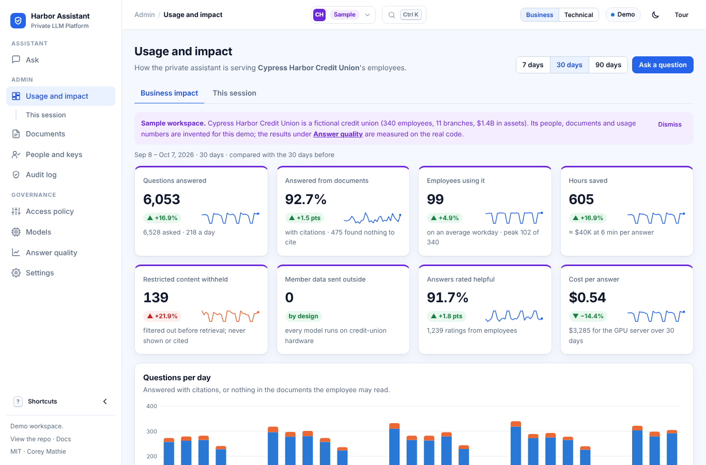

# Console

The console is the platform's user-facing surface: an employee assistant in front, with administration and
governance behind it. One set of static files serves two purposes. As a public demo it runs the gateway's own
Python modules in the browser against simulated services. As the operator console it is served by the gateway
at `/console/` and calls the real HTTP API. This document covers the two modes, the fictional business the demo
is set in, each screen, and how to run and publish the console.

## Two modes, one codebase

The console is one set of static files in [`demo/`](../demo/): `index.html`, `app.js`, `assistant.js`,
`screens.js`, `adapters.js`, `ui.js` and `styles.css`, with the shared navigation shell in `shell.js`. An
adapter selects the data source; the screens do not know which one is active.

| Mode | Adapter | Behaviour | Header label |
|---|---|---|---|
| **Demo** (GitHub Pages) | `DemoAdapter` | Loads Pyodide 0.26.4 and runs the gateway's own modules through `demo/engine.py`, with a simulated backend (hashed bag-of-words embeddings, extractive answers, a stand-in Ollama model inventory) | *Demo* |
| **Live** | `LiveAdapter` | The gateway serves the same files at `/console/`; the adapter calls its HTTP API with the admin key or token entered on Settings, held in memory, or in `sessionStorage` on request | *Live · connected to &lt;host&gt;* |

The mode comes from `GET ./api-mode` (a static file answers `demo`; the gateway answers `live`) or from
`?mode=demo|live`.

In demo mode the following gateway modules run in the browser through Pyodide: keys and rate limiting, roles
and permission-aware retrieval, citations, the audit hash chain, policy validation, model pinning, and the RAG
eval. Nothing leaves the page. There is no LLM in the browser; answers are extractive and labelled as
**simulated**.

**Start-up.** In demo mode the Ask and Usage and impact screens render at once, while Pyodide loads. The assistant
lists its start-up steps with their progress (loading the Python runtime, the gateway's code and the sample
library, then indexing the documents and access lists) and notes that the first load downloads the Python
runtime and its packages (about 34 MB before compression; `scripts/demo_smoke.py` measures the files Pyodide
requests). Until the engine is ready, names come from a static copy of the personas, suggested questions are
replaced by a neutral placeholder, and the composer is disabled with "Getting ready…". Other screens show the
same steps until they can render.

**Figures and page translation.** Numbers and money are formatted en-US ("$1,100", "$93K", "$1.4B", two decimals below $10)
whatever the browser locale. Elements that hold figures (KPI tiles, tables of numbers, charts, meters, numbers
inside sentences) carry `translate="no"` so browser page translation leaves them as written; labels and prose
remain translatable.

## Sample business: Cypress Harbor Credit Union

The console is set in a sample business so that the platform can be assessed the way an institution would use
it. **Cypress Harbor Credit Union** is *fictional*: 340 employees in 11 departments, 11 branches in South
Florida, and one on-prem GPU server. The console opens on **Harbor Assistant**, the employee-facing chat, following the pattern
of an internal Copilot-style assistant; administration and governance sit behind it in the sidebar.

- **Library**: 59 documents in six collections (staff policies, member information, member services, lending,
  compliance, branch operations), each with an owner, department, version and review date (all within 12 months
  of the usage period). 46 come from [`scripts/sample_library.py`](../scripts/sample_library.py), which is also
  the single source for the department list, document owners and access rules (checked in CI). Member
  information (fees, hours, rates, how to join) is written for members and is readable by `group:public` and
  `group:staff`; every other collection is `group:staff` only. HR compensation (`group:hr`), the payments
  on-call runbook (`group:engineering`) and the BSA/AML escalation procedure (`group:compliance`) are restricted
  by document access list; front-line staff refer unusual activity under an all-staff referral policy.
- **People**: Priya Shah (Human resources), Dana Ortiz (IT and digital banking), Marcus Bell (Compliance and
  BSA, the BSA officer), Audrey Kim (Internal audit: `reader:*`, read-only across every collection, restricted
  documents still hidden, no free-form chat) and the branch lobby kiosk (an API key in `group:public`, so it
  reads Member information only). Suggested questions per person come from `demo/engine.py` and each is tested
  to cite the document it demonstrates; Audrey's salary-band suggestion is labelled as a refusal. The demo also
  creates two API keys: `member-faq-portal` (`group:public`) and `staff-intranet-search` (`group:staff`). API
  keys and the bootstrap admin appear in the technical view.
- **Usage**: 90 days from [`scripts/generate_sample_company.py`](../scripts/generate_sample_company.py),
  labelled **sample** everywhere, apart from **measured** results (Answer quality, Benchmarks) and the
  **simulated** requests made in the tab.

## How the sample numbers were set

The Usage and impact figures are generated **sample** data, calibrated to published sources where one was found.
Each headline figure, the assumption behind it and its published sources live in one table in
[`scripts/generate_sample_company.py`](../scripts/generate_sample_company.py) (`SOURCES` and `headline_figures`,
written to `demo/data/sample_company.json`); the console's *How these sample numbers were set* panel and the table
below render from it, and a test keeps them identical. A figure is marked cited only with a source that was fetched
and read in full, with its title, publisher, year, URL, access date and the quoted sentence (a table row is quoted as
its label and values); a test fails if a cited figure has no URL, and the same test checks that the generator's
parameters are the quoted figures. 5 of 11 figures are cited. Where a sample value was outside a cited
figure, the generator was changed so it lands inside: 30-day adoption fell from 86% to 53% of staff (and the average
workday from 217 to 99 employees) to sit near published rates of AI use at work, which lowers questions in 30 days
from 14,430 to 6,528 and hours saved from 1,337 to 605 (now 1.0% of all staff hours, under the published 2.2%); the
hourly cost moved from an assumed $52 to the BLS figure of $65.97; and the monthly infrastructure cost moved from an
assumed $4,200 to $3,285, two L40S GPUs at a public on-demand rate, so cost per answer rose from $0.31 to $0.54. The
other figures remain assumptions, labelled as such.

| Figure | Sample value (last 30 days) | How it was set | Source |
|---|---|---|---|
| Members and assets | 92,400 members and $1.4B in assets: $15,152 in assets per member | Set for a mid-size credit union. Federally insured credit unions hold about $17,100 in assets per member ($2.50 trillion for 146.1 million members, NCUA, June 30, 2026); the sample is 11% below that average. | [Quarterly Credit Union Data Summary 2026 Q2](https://ncua.gov/files/publications/analysis/quarterly-data-summary-2026-Q2.pdf), National Credit Union Administration, 2026 (accessed 2026-11-05): "As of June 30, 2026, there were 4,214 federally insured credit unions with 146.1 million members. ... Total assets in federally insured credit unions rose by $120 billion, or 5.0 percent, over the year ending in 2026Q2, to $2.50 trillion." |
| Staffing ratios | 340 employees: 272 members and $4.1M in assets per employee | Set for a mid-size credit union. NCUA's quarterly summary reports members and assets but not employees, and no published members-per-employee figure has been checked. | Assumption (no public benchmark cited) |
| Employees using it | 181 of 340 employees (53%) asked at least one question in 30 days; 99 (29%) on an average workday | Department shares in STAFFING (25% to 75% of staff in 30 days) and a workday share that rises after launch, set close to published rates of AI use at work: roughly half of financial-activities employees use AI daily or weekly (Gallup, January to March 2026), and 39.2% of employed adults used generative AI for work in the past week (Real-Time Population Survey, Q2 2026). | [AI Benefits at Work Unevenly Distributed](https://news.gallup.com/poll/714602/benefits-work-unevenly-distributed.aspx), Gallup, 2026 (accessed 2026-11-05): "Roughly half of employees in the professional and business services, financial activities and information/media industries regularly use AI."<br>[Does generative AI save time at work?](https://fred.stlouisfed.org/blog/2026/08/does-generative-ai-save-time-at-work), Federal Reserve Bank of St. Louis, FRED Blog, 2026 (accessed 2026-11-05): "The share of employed adults who used generative AI for work in the past week grew from 28.2% in Q3 2024 to 39.2% by Q2 2026, indicating adoption is broadening." |
| Questions per active employee | 2.9 per workday (6,528 in 30 days) | Per-department questions per active user per workday (1.2 to 4.5 in STAFFING). | Assumption (no public benchmark cited) |
| Hours saved | 6 minutes per cited answer: 605 hours in 30 days, 0.8 hours per active employee per week (2.0% of a 40-hour week), 1.0% of all staff hours | Minutes saved per answer (versus searching shared drives or asking a colleague) are an assumption. The result, 2.0% of an active employee's week and 1.0% of all staff hours, stays below published self-reported savings from generative AI: 5.4% of users' work hours, and 2.2% of employed adults' work hours (Q2 2026). | [Generative AI, Productivity and the Future of Work](https://www.stlouisfed.org/open-vault/2025/oct/generative-ai-productivity-future-work), Federal Reserve Bank of St. Louis, Open Vault, 2025 (accessed 2026-11-05): "On average, generative AI users reported saving time amounting to 5.4% of their work hours, or roughly 2.2 hours per week in a 40-hour work week."<br>[Does generative AI save time at work?](https://fred.stlouisfed.org/blog/2026/08/does-generative-ai-save-time-at-work), Federal Reserve Bank of St. Louis, FRED Blog, 2026 (accessed 2026-11-05): "Perhaps most importantly, the share of work hours saved thanks to AI assistance grew from 1.6% to 2.2%." |
| Loaded hourly cost | $65.97 per hour | Wages plus benefits per hour: the BLS total compensation cost for private-industry credit intermediation (June 2026), used as published. | [Employer Costs for Employee Compensation, Table 4. Private industry workers by occupational and industry group (June 2026)](https://www.bls.gov/news.release/ecec.t04.htm), U.S. Bureau of Labor Statistics, 2026 (accessed 2026-11-05): "Credit intermediation and related activities industry: Total compensation, Cost ($) 65.97; Wages and salaries 42.35; Total benefits 23.62" |
| Infrastructure cost | $3,285 per month: $0.54 per answer | Two NVIDIA L40S GPUs at the public on-demand rate for an 8-GPU L40S instance ($18.00 an hour, so $4.50 for two) for 730 hours a month. The on-prem server, with power and support, is assumed to cost no more than renting the same GPUs. | [CoreWeave Cloud Pricing](https://www.coreweave.com/pricing), CoreWeave, 2026 (accessed 2026-11-05): "NVIDIA L40S (GPU Count 8, North America): On-Demand Price: $18.00 / Hour" |
| Answered from documents | 92.7% of questions answered with citations | The share that finds nothing to cite falls from about 11% to about 7% over 90 days as the library fills its gaps; no comparable published rate for an internal policy assistant has been checked. | Assumption (no public benchmark cited) |
| Answers rated helpful | 91.7% of 1,239 ratings; 20% of answers rated | Rating rate and helpful share chosen for illustration. | Assumption (no public benchmark cited) |
| Response time | median 1.6 s, slowest-day 95th percentile 4.5 s | Chosen for illustration; the gateway's own overhead is measured separately (docs/benchmarks.md). | Assumption (no public benchmark cited) |
| Restricted content withheld | 2.1% of questions | Share of questions that touch a document the asker is not cleared for (1.8% to 3% a day). | Assumption (no public benchmark cited) |

## Business and technical views

The header switch (or `?view=technical`) selects the audience. The business view shows what employees and
administrators see: plain-language access ("Restricted to the hr group"), document titles, and readable
audit-event names. The technical view adds retrieval scores and modes, API keys and token limits, raw
access-list entries, model digests, the lock file and ML-BOM, and the modules running in the tab. Light and
dark themes follow the system and can be switched in the header.

## Asking across every readable collection

*All sources I can read* (the default) searches every collection the person may read. The access decision
runs per collection before any passage is scored; passages are then ranked together. In demo mode an answer
quotes and cites only one document: the retrieved document that contains the most of the question's words. A
question that nothing in the library answers well receives "I couldn't find that in the documents you can
access" instead of an unrelated quote: in demo mode when the best passage's vector similarity is below a floor,
or when no retrieved document contains at least two of the question's content words. The eval goes through the same path and reports how often it declines when it should, and how often it
declines a question it could have answered ([evals/README.md](../evals/README.md)).

## Navigation

Screens are grouped as Assistant, Admin and Governance, with breadcrumbs, a command palette
(<kbd>Ctrl</kbd>/<kbd>⌘</kbd> <kbd>K</kbd> or <kbd>/</kbd>), `g` + letter shortcuts (<kbd>?</kbd> lists them)
and a collapsible sidebar. A five-step guided tour is offered on the first visit.



## Screens

| Screen | Function |
|---|---|
| Ask | Chat with streamed answers, numbered citations and source cards; a citation opens the document with the quoted passage highlighted, its owner, version, review date and who may read it. Conversation history, suggested questions per person, copy / ask again / helpful / not helpful, ask as someone else or compare two people side by side, search one collection or all. Technical view: retrieval mode, reranker, passage count, model-only chat (readers get 403) and a retrieval-details table per answer (scores, access rule, injection flags, audit line) |
| Usage and impact | For the sample credit union over 7, 30 or 90 days: questions answered, share answered from documents with citations, employees using it, hours saved and cost per answer (with stated assumptions), restricted content withheld, member data sent outside (zero), answers rated helpful, each against the previous period; questions per day; adoption by department; topics; response time; knowledge-base collections and who may read them; governance checks; recent activity; how each sample number was set, with its assumption or source |
| Usage and impact › This session | Requests, identities, collections and documents, audit status and access decisions for what was done in this tab; guided "what to try" cards |
| Documents | The library with titles, owners and review dates, a filter, add or upload, per-collection and per-document access lists, and a plain-language access matrix of who can read which document |
| People and keys | People and applications with their roles and groups; API keys with usage against the rate limit, burst test and revoke (technical view); SSO group-to-role mapping |
| Audit log | The hash-chained log with readable event names, filters, search and paging; each row opens a decision timeline (sign-in, access decision, retrieval, sources, answer, hashes). "Log intact" check; demo mode adds a tamper-detection test |
| Access policy | The policy in effect, in plain language, then the runtime policy as JSON, validated with the gateway's own types and `identity.check_role`, applied and audited, with a "try a change" scenario before and after |
| Models | Backend health, served models, off/warn/enforce policy; the technical view adds digests, lock-file verification and validation, and ML-BOM model components |
| Answer quality | The `scripts/rag_eval.py` scorecard per configuration against `evals/thresholds.json`, measured on the Cypress Harbor library itself with 59 gated questions, plus the 296-question development set and the 183-question held-out set, each against its own thresholds, asked as the five people (including questions to decline), with the share of answerable questions declined, and the questions not answered perfectly with who asked them; demo mode re-runs the gated set in the browser and compares |
| Settings | Mode, credential (live), modules running in the tab (technical view), and what is simulated |

## Running the console against the gateway

```bash
docker compose up        # then open http://localhost:8080/console/
docker compose logs gateway | grep "Bootstrap admin"     # the admin key to paste on Settings
```

That stack needs no model or GPU. The gateway talks to `mock-llm`, which is
[`scripts/mock_openai_server.py`](../scripts/mock_openai_server.py) in **simulated** mode (extractive answers,
hashed embeddings; not a language model). *Load sample data* on Usage and impact › This session adds the sample
library, each collection's access list and three keys (`hr-assistant` and `eng-assistant` in `group:staff`,
`lobby-kiosk` in `group:public`) through the API.

For real answers, Ollama remains the default backend:
`docker compose --env-file profiles/compose-ollama.env --profile ollama up -d`, then pull `llama3.1:8b` and
`nomic-embed-text` (see the top of `docker-compose.yml`). The earlier single-file admin page is still served at
`/admin`.

## Console endpoints

The console added these endpoints, all admin-only: `GET /admin/overview`, `GET /admin/audit/entries`,
`GET /admin/access-matrix?collection=`, `GET /admin/policy`, `POST /admin/policy/validate`,
`PUT /admin/policy` (in memory, audited as `policy_changed`; a restart reads the environment again),
`GET /admin/rate-limits`, `POST /admin/models/lock/validate` and `GET /admin/models/mlbom`. In addition,
`GET /console/api-mode` and per-request `retrieval_mode` / `reranker` on `/ask`.

## Verification

The browser engine runs under CPython in the test suite (`tests/test_demo_engine.py`,
`tests/test_console_engine.py`). `scripts/demo_smoke.py` drives the real console headlessly with Playwright in
both modes: every screen and its key interaction in demo mode, then the gateway and the simulated backend under
uvicorn in live mode (47 checks, no console errors, no horizontal scroll at 390 px). See
[testing.md](testing.md).

## Publishing the demo

Enable GitHub Pages for the repository (Settings → Pages → deploy from the `main` branch, root folder). The
console is then at `https://coreymathie.github.io/private-llm-platform/demo/`. `.nojekyll` makes Pages serve the
Python files as-is.
